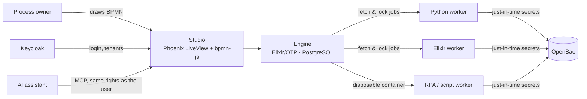

# Flowloom — BPMN 2.0 process automation platform

> **Showcase repository.** The source code is private; this page explains what Flowloom does, how it is built and which decisions shaped it. Happy to walk through the code in an interview.

Flowloom lets process owners **draw a business process in standard BPMN 2.0 and run it** — with approvals, forms, timers, messages, decision tables and external workers that do the actual work. It is a personal project I build alongside my job applications, and the place where my automation experience (UiPath, Power Automate, n8n, Camunda/ProcessCube) comes together.

**Status:** in active development. Runs in the dev environment of my [homelab](https://github.com/1a-khan/homelab) (k3s, Argo CD); ~110 ExUnit test files, CI on every push. Not in production use by customers.

---

## The problem

Low-code tools make the first automation easy, then get hard to run: no versioning, no review before a change goes live, credentials scattered across flows, and the process logic hidden in a proprietary format. Flowloom keeps the **process as standard, portable BPMN XML**, and treats reliability, secrets and promotion (dev → staging → prod) as core features, not afterthoughts.

## Architecture

- **The engine only orchestrates.** It tracks tokens, waits and message correlation, and never executes task code. BPMN controls the process, OTP controls runtime reliability, workers do the work.
- **Workers pull jobs** over an HTTP protocol modelled on Camunda's External Task pattern (`register` → `fetch_and_lock` → `complete` / `fail` / `extend_lock`). They only need outbound network access — no inbound firewall rules at the customer.
- **Two execution lanes:** trusted, warm workers for API calls and AI reasoning; disposable containers for RPA and ad-hoc scripts, so leaked state dies with the job. RPA jobs are not retried by default — a redelivered job must not send a real letter twice.

## What runs today

| Area | Built |
|---|---|
| BPMN tasks | Service, user (forms, assignees, approve/reject), script, send/receive, business rule (own decision tables), call activity, multi-instance |
| Gateways | Exclusive, parallel, inclusive, event-based |
| Events | Message, signal, timer (incl. cron start), conditional, link, error, escalation, compensation, terminate; boundary and event sub-processes |
| Triggers | Webhook start events; polling triggers via the worker protocol; Elixir SDK |
| Credentials | Tasks reference a **logical connection name**; the secret path resolves per environment in OpenBao, fetched just-in-time, never baked into env vars |
| Identity | Keycloak login; Keycloak Organizations as tenants; API keys for machines |
| Promotion | Export bundle (BPMN XML + task config JSON) → Git → CI dry run against staging → approval → prod. Staging and prod Studios are read-only |
| AI | Flowloom is an **MCP server**: an AI assistant can read and build processes with exactly the rights of its user. Ad-hoc sub-process built as the base for agentic steps |
| Quality | ExUnit tests, CI, browser "bad-day" resilience checks (dropped Wi-Fi, sleeping laptop, deploy during editing) after a real incident |

**Planned:** AI agent step that chooses tools itself (with guardrails), Python/TypeScript worker SDKs, disposable RPA workers.

## Decisions I'd like to discuss

- **Why not build on Windmill?** My first engine used it for task execution. Its community licence forbids running it as a managed service, which conflicts with a multi-tenant product — so Flowloom owns its worker protocol.
- **Why one engine per environment** instead of one engine with environment flags.
- **Why agentic behaviour stays inside BPMN** (ad-hoc sub-process, as Camunda does) rather than a custom node type — the exported XML stays standard.
- **Why Keycloak Organizations** instead of a realm per tenant.

## Stack

Elixir · Phoenix LiveView · OTP · PostgreSQL · bpmn-js · OpenBao · Keycloak · Docker · k3s · Argo CD · GitHub Actions · MCP · Python workers

## More

- Architecture write-up with diagrams (Notion): <https://www.notion.so/3d6b677ed9b481e78a48f22a737fea5e>
- Portfolio overview: <https://app.notion.com/p/My-Portfolio-Project-3d6b677ed9b481b08e53ebdb91a359fd>
- Built with AI assistance; architecture, decisions, reviews and operations are my own work.
